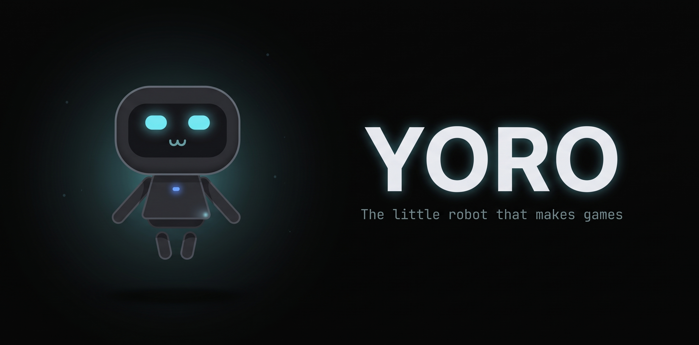
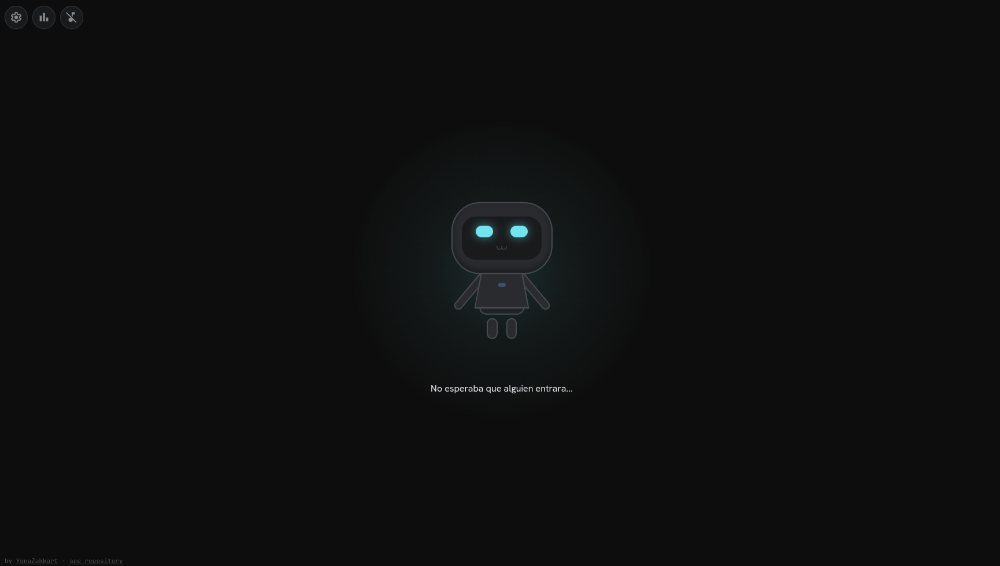
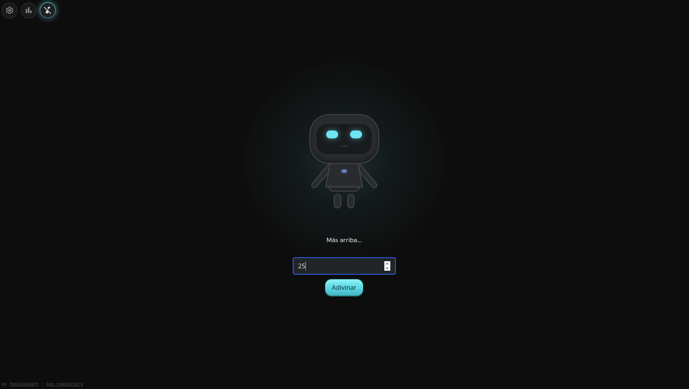
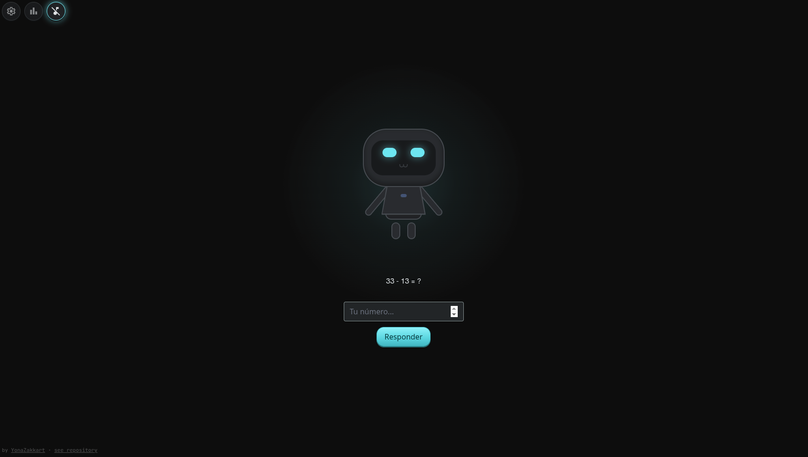
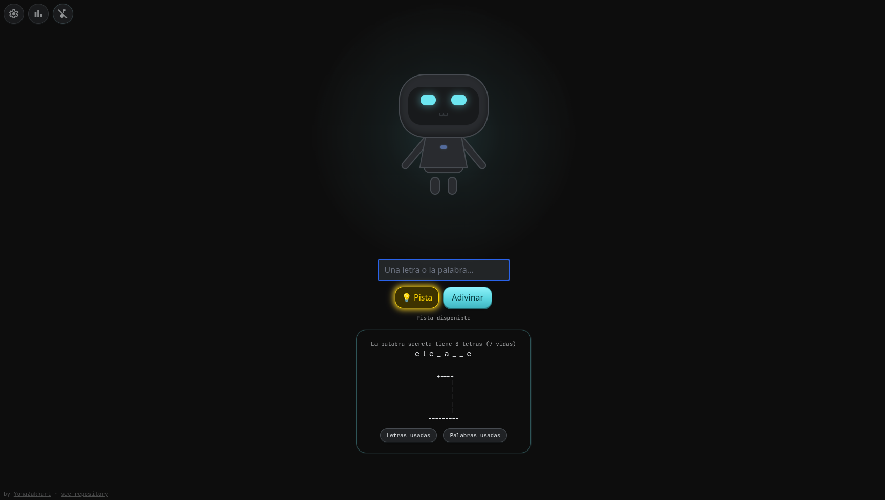
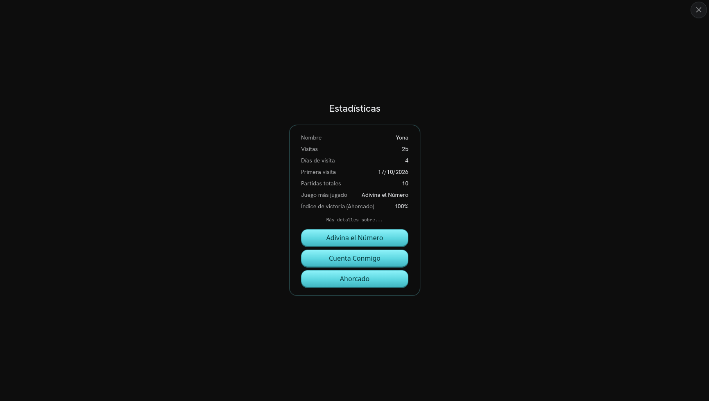
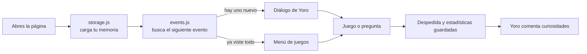

<div align="center">



<br>

<a href="https://yonazakkart.github.io/yoro/">
  
</a>

<br><br>


</div>

---

## Sobre el proyecto

**Yoro** es un pequeño robot que vive dentro de una página web.

Cuando entras por primera vez casi no hay nada, una pantalla oscura, un robot tímido y un par de frases torpes. Poco a poco Yoro descubre que puede hacer cosas. Primero crea un juego muy simple, luego lo mejora, después inventa otro. Con el tiempo recuerda tu nombre, cuántas veces has vuelto y qué juegos te gustan.

La idea es sencilla: **Yoro no empieza siendo impresionante, tiene que ganarse el derecho a serlo** La gracia está en verlo aprender

> Yoro es también un ejercicio de aprendizaje, todo el código es HTML, CSS y JavaScript vanilla, escrito paso a paso, sin frameworks ni herramientas de compilación.

---

## Jugabilidad

Yoro avanza por **eventos**: cada vez que vuelves, si hay algo nuevo que contar, lo cuenta. Una vez que ha mostrado todo, se convierte en un pequeño almacén de juegos donde puedes repetir la versión más reciente de cada uno.

<div align="center">

<br>
<sub>La primera visita: una pantalla casi vacía y un robot que no esperaba compañía.</sub>
</div>

### Los juegos de Yoro

| Juego | Qué es | Modos |
|---|---|---|
| **Adivina el Número** | El primer juego de Yoro. Empieza con un número entre 1 y 10 y termina con pistas y rango de 1 a 50. | Casual (pistas según qué tan cerca estés) y Desafío (el número escapa si fallas demasiado) |
| **Cuenta Conmigo** | Sumas y restas con Yoro. | Casual (10 preguntas) e Infinito (sigue hasta que falles) |
| **Ahorcado** | Letra por letra o la palabra completa, con dibujo ASCII que avanza con cada fallo. | Casual, Desafío y Experto (palabras largas, pistas a cambio de vidas) |

<div align="center">



</div>

### Yoro te recuerda

Yoro guarda una memoria sencilla en tu navegador (`localStorage`): tu nombre, cuántas veces has entrado, cuántos días distintos has venido y cómo te va en cada juego. Cuando la pantalla queda en silencio, comenta alguna de esas curiosidades.

<div align="center">

</div>

### Detalles

- **Música opcional**, desactivada por defecto. Un tema tranquilo para diálogos y menús, y otro cuando empieza una partida.
- **Reacciona a la pestaña**: si te vas, el título de la página cambia a un "¿Te vas...?".
- **Panel de opciones**: cambiar tu nombre, reiniciar estadísticas o reiniciar todo el juego.
- **Botón "Saltar tiempo..."**: para pasar al siguiente evento sin esperar a volver otro día.
- **Instalable como app** gracias al `manifest.json` y a sus íconos.

---

## Cómo jugar

Entra a **[yonazakkart.github.io/yoro](https://yonazakkart.github.io/yoro/)**. No hay que instalar nada.

Para correrlo en tu computadora (descargar):

```bash
git clone https://github.com/YonaZakkart/yoro.git
cd yoro
```

Después abre `index.html` en tu navegador. 

---

## Herramientas

| Herramienta | Para qué se usa |
|---|---|
| HTML5 | Estructura de la página y de todos los paneles |
| CSS3 | Yoro está dibujado solo con CSS, más animaciones y estilo de botones |
| JavaScript | Toda la lógica: diálogos, eventos, juegos, estadísticas y música |
| localStorage | Memoria de Yoro: progreso, nombre, estadísticas y preferencia de música |
| Tailwind CSS (CDN) | Utilidades de diseño |
| Google Fonts | Hanken Grotesk, JetBrains Mono y Material Symbols |
| Git y GitHub | Control de versiones, una rama por cada característica |
| GitHub Pages | Publicación automática con cada merge a `main` |

---

## Estructura del proyecto

```
yoro/
├── index.html          Estructura de la página y paneles
├── style.css           Estilos propios (Yoro, botones, cajas, animaciones)
├── main.js             Lógica de los juegos, ajustes y estadísticas
├── events.js           Motor de eventos, diálogos y menús
├── storage.js          Memoria persistente (localStorage)
├── music.js            Reproductor de música
├── manifest.json       Datos para instalarlo como app
│
├── robot/
│   └── dialogue.js     Diálogos de Yoro
│
├── games/
│   ├── number.js       Adivina el Número
│   ├── math.js         Cuenta Conmigo
│   └── hangman.js      Ahorcado
│
├── assets/
│   ├── icons/          Favicon e íconos de la app
│   └── music/          Pistas de música
│
└── docs/
    └── capturas/       Imágenes de este README
```

### Cómo fluye todo



---

## Ideas a futuro

Yoro todavía está aprendiendo. Entre las ideas guardadas:

- Más juegos y mejoras a los existentes (tal vez)
- Regalos descargables (dibujos ASCII, cartas, pequeños archivos)
- Una habitación que Yoro vaya transformando
- Una pequeña historia de fondo, sutil y melancólica

---

## Créditos

Creado por [YonaZakkart](https://github.com/YonaZakkart)

Asistido por [Claude](https://claude.com/)

Música: pistas con licencia CC0 obtenidas de [OpenGameArt](https://opengameart.org/) 

---

<div align="center">

Si Yoro te sacó una sonrisa, una estrella en el repositorio le dará mucho ánimo

</div>
