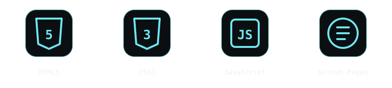
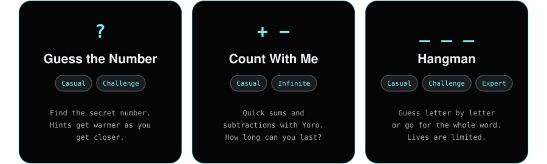

<div align="center">



<br><br>

<a href="https://yonazakkart.github.io/yoro/">
  
</a>

<br><br>



<br><br>



<br><br>



</div>

## How to play

<div align="center">

**Play online** on GitHub Pages

<a href="https://yonazakkart.github.io/yoro/">
  
</a>

</div>

To run it on your computer:

```bash
git clone https://github.com/YonaZakkart/yoro.git
cd yoro
```

Then open `index.html` in your browser.

<br>

<div align="center">



<sub><a href="docs/guide/README.md">Docs</a> · <a href="CREDITS.md">Credits</a></sub>

</div>
