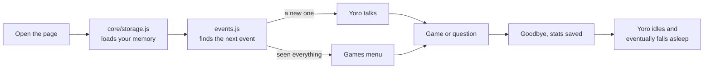

# Project structure

```
yoro/
├── index.html              Page structure, panels and Yoro's SVG drawing
├── manifest.json           App install data
├── CREDITS.md              Credits
│
├── css/
│   └── style.css           Custom styles (Yoro, buttons, boxes, animations)
│
├── js/
│   ├── main.js             Startup: visit, shared input and short messages
│   ├── events.js           Event engine, dialogues and menus
│   ├── core/
│   │   ├── storage.js      Persistent memory (localStorage)
│   │   ├── i18n.js         Language system
│   │   ├── timers.js       Pausable timers (dialogues stop while a panel is open)
│   │   └── music.js        Music player
│   ├── lang/
│   │   ├── es.js           Spanish texts
│   │   └── en.js           English texts
│   ├── robot/
│   │   ├── dialogue.js     Yoro's dialogue lines
│   │   ├── yoro.js         Yoro's animation (gaze, blink, arms, expressions)
│   │   └── moods.js        Yoro's mood (sleep, reactions to taps, errors and skips)
│   ├── games/
│   │   ├── number.js       Guess the Number
│   │   ├── math.js         Count With Me
│   │   ├── hangman-data.js Hangman words and drawings
│   │   └── hangman.js      Hangman
│   └── ui/
│       ├── settings-panel.js  Options panel
│       └── stats-panel.js     Stats panel
│
├── assets/
│   ├── icons/              Favicon and app icons
│   └── music/              Music tracks
│
└── docs/
    ├── guide/              These docs
    ├── og/                 Link preview images (Open Graph, X, GitHub)
    └── svg/                README images
```

## Tools

| Tool | Used for |
|---|---|
| HTML5 | Page and panels |
| SVG + CSS3 | Yoro's drawing, poses and expressions; button styles |
| JavaScript | All the logic: dialogues, events, games, stats, music and moods |
| localStorage | Yoro's memory |
| Tailwind CSS (CDN) | Layout utilities |
| Google Fonts | Hanken Grotesk, JetBrains Mono and Material Symbols |
| GitHub Pages | Publishing on every merge to `main` |

There's no build step: scripts are plain `<script>` tags, and their order in `index.html` matters (dictionaries and storage first, `events.js` last because it starts the flow).

## How it flows


